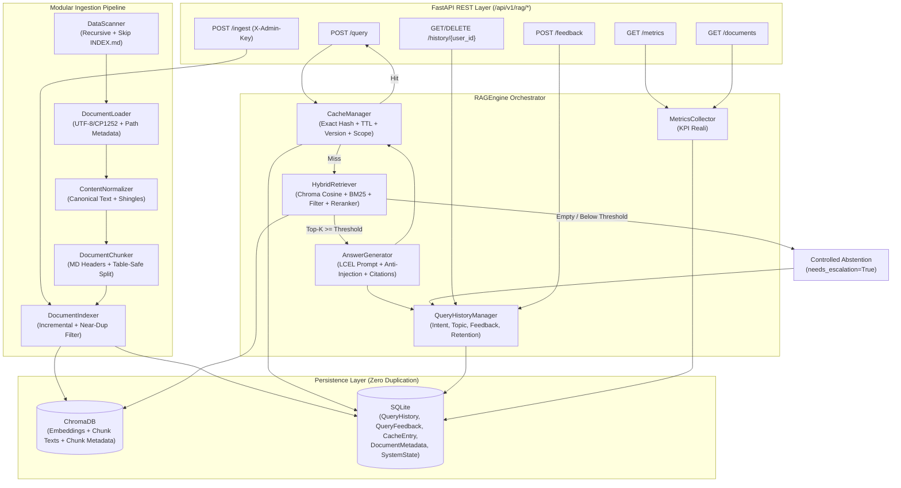

# Operator Copilot — Architettura Tecnica (Milestone 1: RAG Engine)

**Versione:** 0.1.0  
**Stack Principale:** Python 3.13, LangChain (`langchain-core`, `langchain-chroma`, `langchain-huggingface`, `langchain-openai`, `langchain-text-splitters`), ChromaDB, Rank-BM25, FastAPI, Pydantic v2, SQLAlchemy + SQLite.

---

## 1. Visione e Perimetro della Milestone 1

**Operator Copilot** è la base di conoscenza intelligente progettata per evolvere verso una piattaforma completa di formazione aziendale adattiva (generazione di corsi, quiz personalizzati dalle ricerche recenti, monitoraggio delle lacune formative).

In conformità con i vincoli della **Milestone 1**, questa implementazione copre esclusivamente il **motore RAG modulare** e i servizi di persistenza/telemetria preparatori:
- **Incluso:** ingestion incrementale e deduplicazione, chunking strutturato, vector store persistente, retrieval ibrido con soglia di astensione, generazione ancorata con citazioni reali, Smart Question Cache con isolamento per utente, raccolta storico ricerche + feedback, metriche reali, API REST FastAPI e suite di test/valutazione.
- **Escluso (fasi successive):** frontend React/Next.js, generazione automatica di corsi e quiz, dashboard formativa, gestione amministrativa utenti.

---

## 2. Diagramma Architetturale

---

## 3. Decisioni Architetturali Guidate dai Dati (`DATA_ANALYSIS.md`)

L'analisi preliminare dei 1.532 file Markdown reali in `data/` ha guidato scelte tecniche mirate:

1. **Esclusione di `data/INDEX.md` (452 KB / 58.623 parole):**
   - `INDEX.md` è una tabella riassuntiva dell'intero corpus. Indicizzarlo causerebbe il recupero di brevi riassunti tabellari invece dei manuali operativi reali. `DataScanner` lo esclude di default (`SKIP_INDEX_FILES=true`).
2. **Deduplicazione Esatta e Near-Duplicate (`035..039`, copie cross-cartella):**
   - Poiché nel corpus esistono **238 coppie con similarità >= 0,75** che condividono lo stesso titolo H1 (differenziandosi spesso solo per la riga `**Link utili:**`), `DocumentIndexer` calcola un hash canonico (`ContentNormalizer`) e applica un controllo Jaccard su shingle a 5 parole (`NEAR_DUP_THRESHOLD=0.90`) sui documenti omonimi, evitando che `top_k` si saturi con copie identiche.
3. **Chunking Strutturale Markdown + Protezione Tabelle:**
   - I documenti hanno una media di 9,4 heading e 512 file contengono tabelle. `DocumentChunker` usa `MarkdownHeaderTextSplitter` (`#`, `##`, `###`) seguito da uno splitting per blocchi che preserva l'integrità delle tabelle e antepone al testo del chunk il contesto `[Area | Documento | Sezione]`.
4. **Retrieval Ibrido (Dense Cosine + Sparse BM25) + Reranking:**
   - Il dominio CWOL/PA è ricco di acronimi e tasti funzione (`ANPR`, `ANSC`, `AP10`, `SIOPE+`, `IUV`, `VRE`, `F7`). `HybridRetriever` combina la ricerca semantica su ChromaDB (`sentence-transformers/paraphrase-multilingual-MiniLM-L12-v2` o `OpenAIEmbeddings`) con `BM25Okapi` e un `DocumentReranker` che premia copertura dei termini, match di acronimi, documenti più recenti (`doc_year`) e diversità tra documenti (`max_chunks_per_doc=2`).
5. **Astensione Controllata e Anti-Prompt-Injection:**
   - Se nessuno chunk supera `RETRIEVAL_SCORE_THRESHOLD`, il motore si astiene restituendo `needs_escalation=True` senza inventare risposte né sporcare la cache.
   - I contenuti recuperati vengono incapsulati in `<retrieved_context>` con sanitizzazione dei tag di chiusura e istruzione di sistema esplicita per trattare i documenti solo come dati.

---

## 4. Separazione dei Dati tra Vector Store e Database Relazionale

Per evitare duplicazioni tra database applicativo e vector store:
- **ChromaDB (`storage/vectorstore/`)**: conserva unicamente i vettori, il testo dei chunk e i metadati necessari al retrieval e alle citazioni (`document_id`, `source`, `title`, `area_name`, `document_type`, `doc_year`, `section`, `heading_path`, `chunk_id`).
- **SQLite (`storage/operator_copilot.db`)**: conserva stato operativo e analitico tramite SQLAlchemy 2.0:
  - `document_metadata`: tracciamento incrementale (`file_hash`, `normalized_hash`, `status`, `chunk_count`).
  - `cache_entries`: exact question cache con TTL, versioni (`corpus_version`, `prompt_version`, `model_version`) e `user_scope`/`owner_user_id`.
  - `query_history` & `query_feedback`: storico ricerche per utente, intent, topic rilevato e valutazioni.
  - `system_state`: `corpus_version` attivo e `last_indexed_at`.

---

## 5. Smart Question Cache e Isolamento Utente

- **Normalizzazione & Hash:** la domanda viene normalizzata (trim, lowercase, collasso spazi) e combinata in SHA-256 con eventuali filtri metadata e `top_k`.
- **Policy di Invalidazione Automatica:** ogni variazione al corpus (`corpus_version`), al prompt (`prompt_version`), al modello (`model_version`) o la scadenza del `TTL` (`CACHE_TTL_SECONDS`) invalida automaticamente la voce obsoleta.
- **Sicurezza delle Risposte:** le risposte di astensione (`needs_escalation=True`) non vengono mai memorizzate come cache positive.
- **User Isolation:** richieste con `user_scope="public"` usano la cache condivisa su documentazione comune; richieste con `user_scope="private"` sono strettamente isolate per `user_id`.

---

## 6. Predisposizione per Future Evoluzioni Formative

Il modulo `history/` e `analytics/` salva per ogni interazione `user_id`, `topic` (derivato dall'area dei documenti recuperati), `intent` (`procedure`, `troubleshooting`, `navigation`, `comparison`, `general_info`), `needs_escalation` e `rating`.  
L'endpoint `GET /api/v1/rag/history/{user_id}` restituisce già il raggruppamento per argomenti (`topics_summary`), mentre `GET /api/v1/rag/metrics` espone segnali pronti (`learning_readiness`) per generare quiz e percorsi adattivi nelle milestone successive senza assumere che ogni ricerca equivalga a una lacuna formativa.

---

## 7. Evoluzione Milestone 2: AI Knowledge-to-Course Engine

L'architettura sopra descritta è stata estesa nella **Milestone 2** integrando sulla stessa applicazione FastAPI (`/api/v1/academy/*`), sullo stesso DB SQLite e leggendo direttamente i chunk indicizzati in ChromaDB i moduli `knowledge_intelligence/` e `course_generator/`.

Per tutti i dettagli architetturali, lo schema delle 13 nuove tabelle, gli endpoint Academy e il modello Qwen centralizzato, vedere [`docs/MILESTONE_2_KNOWLEDGE_TO_COURSE.md`](MILESTONE_2_KNOWLEDGE_TO_COURSE.md).
