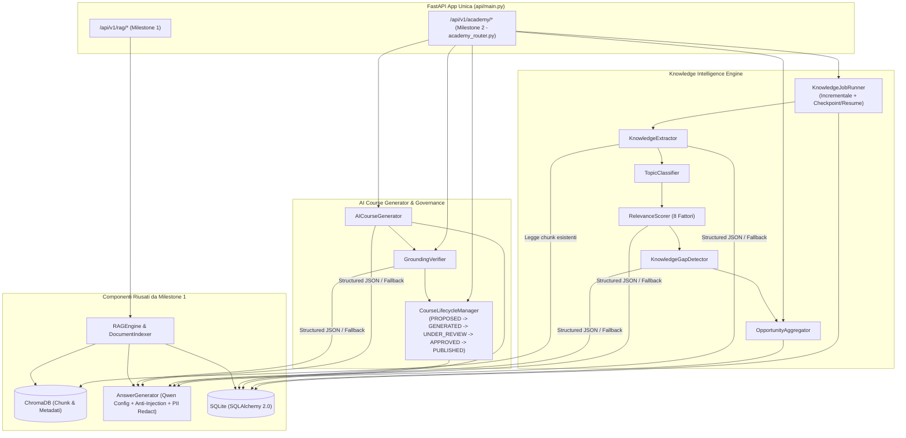

# Operator Copilot — Milestone 2: AI Knowledge-to-Course Engine

**Versione:** 0.2.0  
**Estensione di:** [ARCHITECTURE.md](ARCHITECTURE.md) (Milestone 1 — RAG Engine)

La **Milestone 2** integra nella piattaforma esistente il motore **AI Knowledge-to-Course Engine**, composto da **Knowledge Intelligence Engine** e **AI Course Generator**, riutilizzando entry point FastAPI, database SQLite, vector store ChromaDB, pipeline di chunking e layer LLM centralizzato della Milestone 1 senza riscrivere il motore RAG.

---

## 1. Integrazione con l'Architettura Esistente (Zero Duplicazione)

### Componenti Milestone 1 riutilizzati direttamente
- **Entry point & auth**: `create_app()` e `verify_admin_key` in [`src/operator_copilot/api/main.py`](../src/operator_copilot/api/main.py) montano modularmente [`academy_router.py`](../src/operator_copilot/api/academy_router.py).
- **Chunk & Metadati senza re-indicizzazione**: [`KnowledgeExtractor`](../src/operator_copilot/knowledge_intelligence/extractor.py) legge i chunk già salvati in ChromaDB via `HybridRetriever._get_vectorstore()` e `DocumentMetadata`, ricorrendo al parsing on-demand tramite `DataScanner`, `DocumentLoader` e `DocumentChunker` solo per documenti non ancora presenti nell'indice.
- **Layer LLM centralizzato**: [`AnswerGenerator`](../src/operator_copilot/generation/answer_generator.py) fornisce a tutti i moduli Academy `invoke_structured()` (con `.with_structured_output()` e fallback JSON), `get_model_info()` e `redact_pii()`.

---

## 2. Knowledge Intelligence Engine (`src/operator_copilot/knowledge_intelligence/`)

1. **`KnowledgeExtractor` ([extractor.py](../src/operator_copilot/knowledge_intelligence/extractor.py))**:
   - Estrae in modo strutturato (`ExtractedTopic`): titolo, sintesi, procedure passo-passo, regole operative, concetti ricorrenti, esempi pratici (distinguendo correttamente casi corretti ed esempi `ERRATO`), errori frequenti, vincoli, relazioni tra argomenti, moduli software coinvolti (`CWOL`, `Cityware Client`, `SIOPE+`, `PagoPA`, `OTRS`, `ANPR`, ecc.), ruoli destinatari e passaggi sorgente (`document_id`, `chunk_id`, `section`, `source`, `updated_at`, `excerpt`).
   - Supporta sia generazione strutturata LLM sia estrazione deterministica senza perdita di tracciabilità.

2. **`TopicClassifier` ([classifier.py](../src/operator_copilot/knowledge_intelligence/classifier.py))**:
   - Classifica ogni argomento su **9 categorie predefinite** (`Assistenza tecnica`, `Gestione degli errori`, `Sicurezza e autorizzazioni`, `Normativa e regolamenti`, `Amministrazione e contabilità`, `Gestione documentale`, `Utilizzo del software`, `Best practice operative`, `Procedure operative`).
   - Estendibile dinamicamente tramite `register_category(name, keywords)`.

3. **`RelevanceScorer` ([scorer.py](../src/operator_copilot/knowledge_intelligence/scorer.py))**:
   - Calcola `TopicRelevanceScore` combinando **8 fattori espliciti**:
     - `operational_importance` (peso 22%)
     - `error_criticality` (peso 18%)
     - `operator_autonomy` (peso 15%)
     - `doc_frequency_capped_10pct` (peso **limitato al 10%**, così la mera frequenza nei documenti non domina lo score)
     - `complexity` (peso 10%)
     - `completeness` (peso 10%)
     - `software_role_applicability` (peso 8%)
     - `source_recency` (peso 7%)
   - Mantiene separati `algorithmic_score`, `llm_score` (quando il runtime LLM è attivo) e `unverifiable_factors` (es. anno di revisione assente o LLM non attivo).

4. **`KnowledgeGapDetector` ([gap_detector.py](../src/operator_copilot/knowledge_intelligence/gap_detector.py))**:
   - Individua **4 tipologie di gap** senza inventare informazioni assenti:
     - `insufficient`: documenti troppo sintetici, privi di passaggi numerati e con meno di 2 regole.
     - `incomplete`: riferimenti a file `.pdf` esterni non indicizzati oppure procedure prive di esempi pratici ed errori frequenti.
     - `outdated`: fonti con `doc_year` più vecchio di `KNOWLEDGE_OBSOLETE_YEARS` anni (default `4`).
     - `contradictory`: documenti raggruppati sullo stesso argomento normalizzato che riportano indirizzi email o soglie temporali/numeriche divergenti.

5. **`OpportunityAggregator` ([opportunities.py](../src/operator_copilot/knowledge_intelligence/opportunities.py))**:
   - Crea `TrainingOpportunity` da singoli documenti o da cluster correlati `(area_name, modulo_software/categoria)` fino a 5 documenti per cluster.
   - Distingue percorsi `documental` (comunicazioni, regole, assistenza) e `applicative` (workflow applicativi e gestione errori su software), segnalando eventuali criticità dai `KnowledgeGap`.

6. **`KnowledgeJobRunner` ([job_runner.py](../src/operator_copilot/knowledge_intelligence/job_runner.py))**:
   - Supporta analisi con `scope_type` = `full | document | category | area` e limite `max_documents`.
   - Esecuzione sincrona (`run_async=False`) o asincrona via `ThreadPoolExecutor` (`ANALYSIS_MAX_WORKERS=2`).
   - **Cache incrementale**: salta automaticamente i documenti con `file_hash` invariato per lo stesso tenant (`skipped_unchanged`) salvo `force_reanalyze=True`.
   - **Checkpoint & Ripresa**: salva `processed_sources` e consente la ripresa di job interrotti o falliti con `resume_job(job_id)`.

---

## 3. AI Course Generator & Governance (`src/operator_copilot/course_generator/`)

1. **Prompt Modulari Versionati ([prompts.py](../src/operator_copilot/course_generator/prompts.py))**:
   - Versione predefinita `academy-v1.0` (`COURSE_PROMPT_VERSION`) con `PROMPT_REGISTRY` a 8 prompt specializzati (`extraction`, `classification`, `relevance`, `gap_detection`, `curriculum`, `lesson`, `quiz`, `source_verification`).
   - Tutti i prompt applicano `_SECURITY_GUARD` con isolamento esplicito dentro `<retrieved_context>`.

2. **`AICourseGenerator` ([generator.py](../src/operator_copilot/course_generator/generator.py))**:
   - Converte una `TrainingOpportunity` (o direttamente un documento via `generate_from_document()`) in un corso completo con `CourseModule`, `Lesson` (spiegazione, procedure, esempi pratici, errori frequenti, esercitazioni, riepilogo) e `Quiz` con domande (`multiple_choice`, `true_false`, `operational_scenario`) collegate a `source_document_id`, `source_chunk_id` e `source_section`.
   - Ogni lezione mantiene la tracciabilità granulare tramite `LessonSource`.
   - Consente la rigenerazione mirata di una singola lezione dalle sue fonti (`regenerate_lesson()`), incrementando la revisione del corso.
   - **Nessuna pubblicazione automatica**: ogni corso generato parte sempre in stato `GENERATED` (`published_at=None`).

3. **`GroundingVerifier` ([grounding_verifier.py](../src/operator_copilot/course_generator/grounding_verifier.py))**:
   - Controlla ogni lezione verificando presenza di `LessonSource`, sovrapposizione lessicale minima con i passaggi sorgente, eventuale rimozione dall'indice `DocumentMetadata`, fonti obsolete, compresenza di `Cityware Client` e `CWOL` e, quando l'LLM è attivo, verifica semantica anti-allucinazione.
   - Assegna al corso `grounding_status` (`VERIFIED`, `WARNINGS`, `UNVERIFIED`) e salva il report dettagliato in `grounding_report`.

4. **`CourseLifecycleManager` ([lifecycle.py](../src/operator_copilot/course_generator/lifecycle.py))**:
   - Gestisce le transizioni consentite: `PROPOSED -> GENERATED -> UNDER_REVIEW -> APPROVED -> PUBLISHED` (oltre a `REJECTED` e `NEEDS_UPDATE`).
   - Impedisce transizioni non valide (es. salto diretto `GENERATED -> PUBLISHED`) e **blocca la pubblicazione** se `grounding_status == "UNVERIFIED"`.
   - Salva snapshot immutabili in `CourseRevision` e registra ogni azione in `CourseApprovalEvent`.
   - Confronta `Course.source_hashes` con gli hash attuali in `DocumentMetadata` (`detect_impacted_courses()`) per marcare `NEEDS_UPDATE` i corsi impattati da aggiornamenti o cancellazioni delle fonti.

---

## 4. Schema Database Aggiunto (`src/operator_copilot/db/models.py`)

Oltre alle tabelle RAG della Milestone 1, sono state aggiunte **13 nuove tabelle SQLAlchemy 2.0**:

| Tabella | Classe ORM | Scopo |
|---|---|---|
| `knowledge_analysis_jobs` | `KnowledgeAnalysisJob` | Stato avanzamento job, incrementale e ripresa da checkpoint |
| `extracted_topics` | `ExtractedTopic` | Conoscenze strutturate estratte e `source_passages` per documento/tenant |
| `topic_relevance_scores` | `TopicRelevanceScore` | Punteggi multi-fattore con separazione score algoritmico / LLM |
| `knowledge_gaps` | `KnowledgeGap` | Lacune rilevate (`insufficient`, `incomplete`, `outdated`, `contradictory`) |
| `training_opportunities` | `TrainingOpportunity` | Proposte formative aggregate (`documental` / `applicative`) |
| `courses` | `Course` | Corsi generati, stato lifecycle, versioni, hash fonti e stato grounding |
| `course_modules` | `CourseModule` | Moduli didattici ordinati appartenenti a un corso |
| `lessons` | `Lesson` | Lezioni strutturate con procedure, esempi, errori ed esercitazioni |
| `lesson_sources` | `LessonSource` | Collegamento diretto lezione -> `document_id`, `chunk_id`, `section`, `excerpt` |
| `quizzes` | `Quiz` | Verifiche di apprendimento associate a un corso o a una lezione |
| `quiz_questions` | `QuizQuestion` | Singole domande con risposta, spiegazione e riferimento al chunk sorgente |
| `course_revisions` | `CourseRevision` | Snapshot JSON immutabili per modifiche e rigenerazioni |
| `course_approval_events` | `CourseApprovalEvent` | Audit trail completo delle transizioni di approvazione/pubblicazione |

---

## 5. Endpoint REST (`/api/v1/academy/*`)

Tutti gli endpoint sono definiti in [`src/operator_copilot/api/academy_router.py`](../src/operator_copilot/api/academy_router.py):

| Metodo & Path | Auth | Descrizione |
|---|---|---|
| `GET /api/v1/academy/llm-status` | Pubblico | Verifica configurazione Qwen, endpoint base e modalità attiva (`llm` vs `deterministic_fallback`) |
| `POST /api/v1/academy/analysis/jobs` | `X-Admin-Key` | Avvia analisi incrementale (`full`, `document`, `category`, `area`) |
| `POST /api/v1/academy/analysis/jobs/{job_id}/resume` | `X-Admin-Key` | Riprende un job interrotto o fallito dal checkpoint salvato |
| `GET /api/v1/academy/analysis/jobs/{job_id}` | Tenant | Stato e contatori di avanzamento del job |
| `GET /api/v1/academy/topics` | Tenant + RBAC | Elenco argomenti estratti (filtrabile per `category` e `area_name`) |
| `GET /api/v1/academy/topics/{topic_id}/score` | Tenant + RBAC | Dettaglio fattori e score di rilevanza dell'argomento |
| `GET /api/v1/academy/gaps` | Tenant + RBAC | Elenco knowledge gap (filtrabile per `gap_type`) |
| `GET /api/v1/academy/opportunities` | Tenant + RBAC | Proposte formative ordinate per `relevance_score` |
| `POST /api/v1/academy/opportunities/build` | `X-Admin-Key` | Costruisce proposte formative da documento o argomenti estratti |
| `POST /api/v1/academy/courses/generate` | `X-Admin-Key` | Genera un corso da `opportunity_id` o `document_source` (stato iniziale `GENERATED`) |
| `GET /api/v1/academy/courses` | Tenant + RBAC | Elenco corsi accessibili con moduli, lezioni, fonti e quiz |
| `GET /api/v1/academy/courses/impact-check` | Tenant | Individua corsi impattati da variazioni/rimozioni delle fonti e opzionalmente marca `NEEDS_UPDATE` |
| `GET /api/v1/academy/courses/{course_id}` | Tenant + RBAC | Dettaglio completo di un corso |
| `PATCH /api/v1/academy/courses/{course_id}/lessons/{lesson_id}` | `X-Admin-Key` | Modifica manuale di una lezione con ri-verifica grounding e nuova `CourseRevision` |
| `POST /api/v1/academy/courses/{course_id}/lessons/{lesson_id}/regenerate` | `X-Admin-Key` | Rigenera una singola lezione dalle sue fonti creando nuova revisione |
| `POST /api/v1/academy/courses/{course_id}/quizzes/generate` | `X-Admin-Key` | Genera un quiz sul corso o su una singola lezione |
| `POST /api/v1/academy/courses/{course_id}/validate` | Tenant | Esegue validazione completa di grounding e versioni fonti |
| `POST /api/v1/academy/courses/{course_id}/lifecycle` | `X-Admin-Key` | Esegue transizione controllata (`UNDER_REVIEW`, `APPROVED`, `REJECTED`, `PUBLISHED`) |
| `GET /api/v1/academy/courses/{course_id}/sources` | Tenant + RBAC | Restituisce tutte le fonti originali per ciascuna lezione |
| `GET /api/v1/academy/courses/{course_id}/revisions` | Tenant + RBAC | Storico revisioni ed eventi di approvazione |

### Sicurezza, Multi-Tenancy, PII e Sanitizzazione Swagger
- **Multi-tenancy & RBAC**: gli header `X-Tenant-ID` (default `default`), `X-User-Role` (default `operatore`) e `X-User-ID` (default `anonymous`) isolano dati e visibilità tramite `tenant_id` e `allowed_roles`.
- **Anti-spoofing ruolo `admin`**: l'invio di `X-User-Role: admin` senza un header `X-Admin-Key` valido viene rifiutato con HTTP `403`.
- **Redazione PII prima dell'LLM (`PII_REDACT_BEFORE_LLM=true`)**: `AnswerGenerator.redact_pii()` maschera Codici Fiscali, IBAN e indirizzi email personali prima di chiamate LLM esterne (preservando gli indirizzi operativi ufficiali `@palitalsoft.it` / `@palinformatica.it` citati nei manuali) e neutralizza tag `</retrieved_context>`.
- **Sanitizzazione Swagger UI**: i DTO in [`schemas/academy.py`](../src/operator_copilot/schemas/academy.py) ignorano i segnaposto `"string"` precompilati da Swagger su `opportunity_id`, `document_source`, `scope_value`, `area_name`, `lesson_id` e `allowed_roles`.

---

## 6. Configurazione LLM Centralizzata (Qwen)

In [`Settings`](../src/operator_copilot/config/settings.py) e [`.env.example`](../.env.example):
- `LLM_PROVIDER=openai_compatible` (o `ollama` / `openai` / `extractive`)
- `LLM_MODEL=qwen2.5:7b-instruct`
- `LLM_EXPECTED_MODEL_FAMILY=qwen`
- `COURSE_PROMPT_VERSION=academy-v1.0`
- `KNOWLEDGE_OBSOLETE_YEARS=4`
- `PII_REDACT_BEFORE_LLM=true`
- `ANALYSIS_MAX_WORKERS=2`

Se nessun server LLM/Ollama è configurato o raggiungibile, tutti i servizi applicano automaticamente il fallback deterministico strutturato senza bloccarsi.

---

## 7. Verifica e Limitazioni Note

- **Test automatici**: [`tests/test_knowledge_to_course.py`](../tests/test_knowledge_to_course.py) copre pipeline su documento reale (`2024_c07_modalita_corretta_richiesta_assistenza_clienti.md`), correlazione multi-documento, gap `insufficient`/`outdated`/`contradictory`, blocco pubblicazione `UNVERIFIED`, lifecycle + revisioni + impatto modifiche fonti, job incrementale + `resume_job`, isolamento tenant/RBAC/anti-spoofing, sanitizzazione Swagger, PII redaction e generazione strutturata con mock Qwen (`26 passed in 9.61s` su tutta la suite).
- **Limitazioni dell'ambiente attuale**:
  - Esecuzione asincrona basata su `ThreadPoolExecutor` locale + SQLite (nessun worker distribuito Celery/Redis).
  - Contesto identità applicativa gestito via header HTTP + `X-Admin-Key` in attesa dell'integrazione con un IdP SSO/OIDC aziendale.
  - L'endpoint Qwen live non è attivo su questa macchina: le chiamate LLM sono state verificate tramite `QwenMockChatModel` e fallback deterministico.
